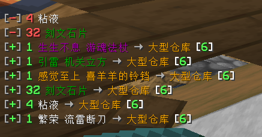
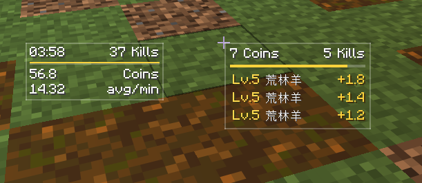
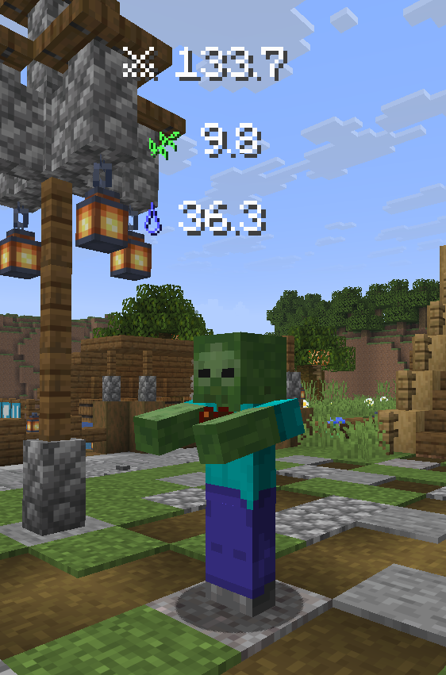
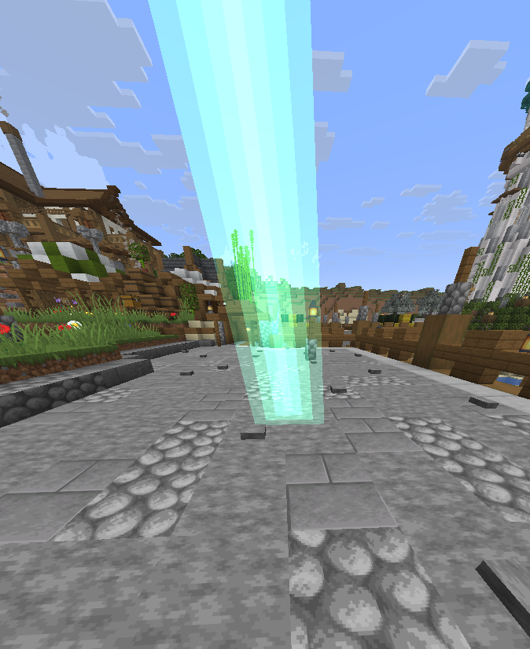
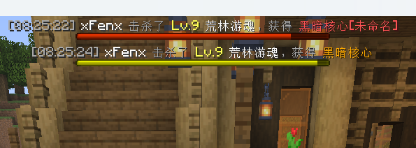
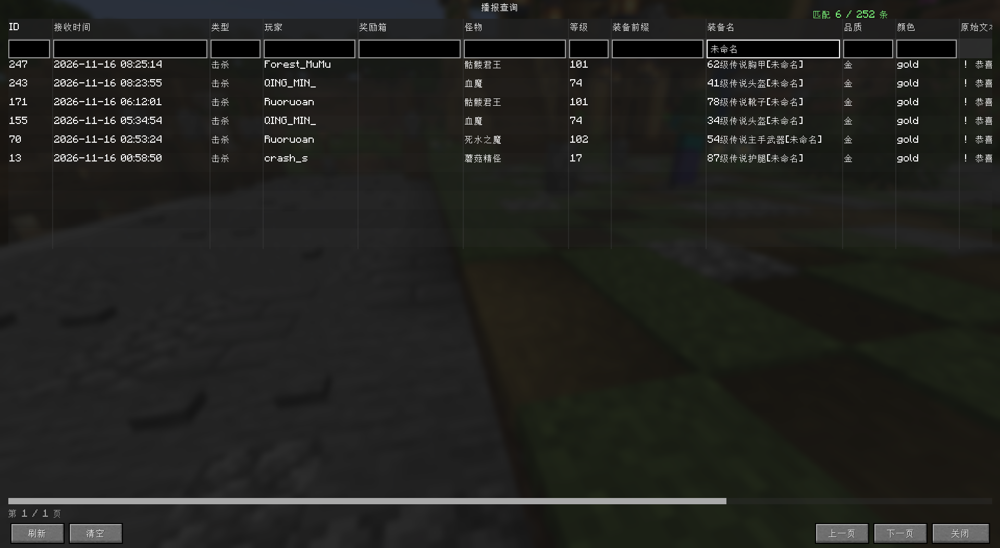
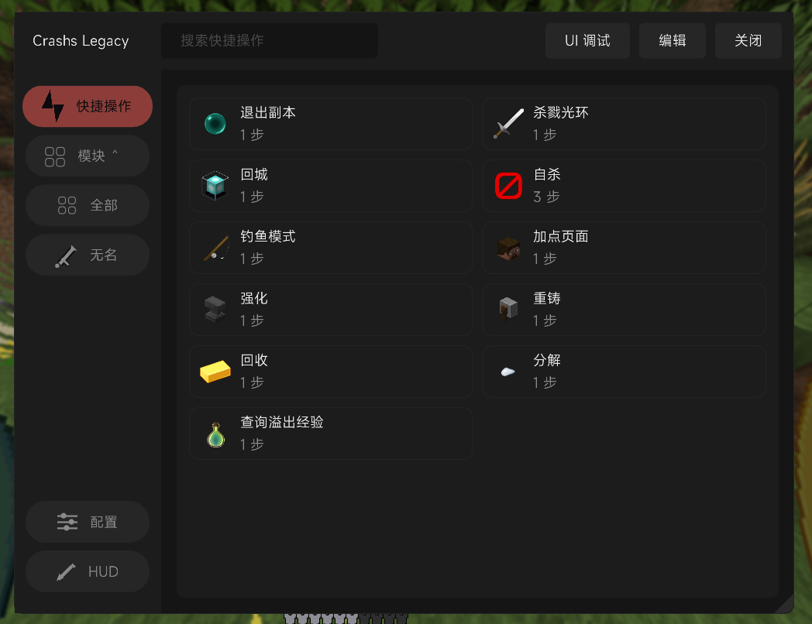
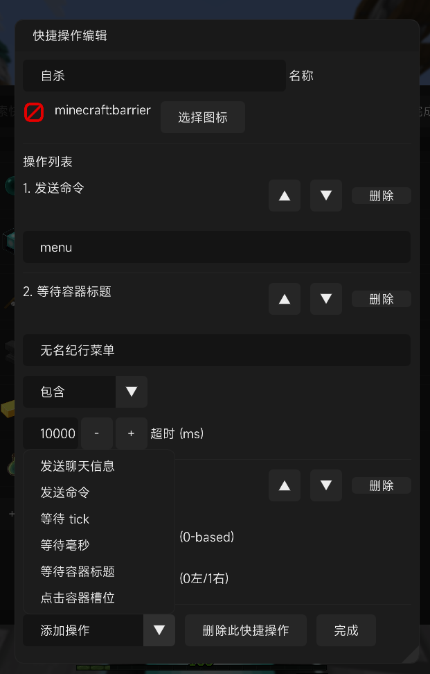
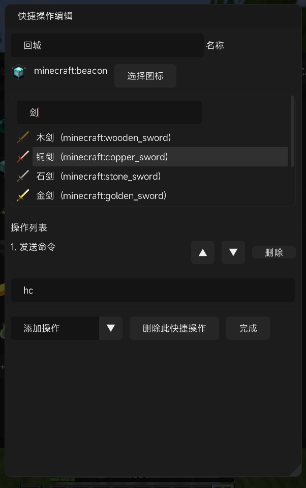

# Crashs Legacy

> 快速跳转：[功能截图](#功能截图) · [安装](#安装) · [功能概览](#功能概览) · [常用命令](#常用命令) · [更新日志](CHANGELOG.md)

Minecraft 1.21.11 的 Fabric 客户端功能集合，为无名纪行服务器定制：

**击杀反馈 · 金币统计 · 库存管理 · 播报管理 · 播报查询 · 服务器伤害显示 · 闪电管理 · 快捷操作 · 聊天调试**

全部功能通过 F7 打开的内置界面配置，支持深色/浅色主题与 6 种强调色。

# 功能截图

## 库存管理

捕获仓库插件的自动收纳提示（`[PlayerInv] 5x 晶簇鲷 ==> 大型仓库 [1]`），逐条显示在独立 HUD 上，
聊天框保持干净。行内保留服务器原始颜色，数量、前缀与箭头按统一样式绘制。



## 击杀反馈与金币统计

`击杀反馈` 解析击杀金币、显示连杀列表与音效；`金币统计` 独立显示会话时长、总击杀、总金币与平均值。



## 服务器伤害数字

识别服务器生成的伤害 TextDisplay，支持背景透明、阴影和玩家受伤文本。



## 闪电管理

隐藏天空闪烁、丢弃闪电实体生成包、修改闪电颜色，并提供原版 / 无音效 / 指定音效三种音效模式。



## 播报 BossBar

支持本玩家/其他玩家、关键词/红色/其他分类，以及分类独立的 BossBar、聊天拦截、时间和音效。



## 播报查询

按列筛选 SQLite/CSV 记录，支持分页、tooltip 和复制原始文本。



## 快捷操作

快捷操作页把常用命令和宏做成卡片，支持真实的 64×64 物品模型图标、搜索、编辑和拖拽排序。



### 快捷操作编辑

步骤支持发送聊天/命令、等待 tick、等待毫秒、等待容器标题和点击容器槽位；
「等待容器标题」会等待服务器真正打开指定容器后再继续，默认包含匹配、10 秒超时。



### 图标选择器

图标选择器使用真实物品模型渲染，虚拟列表可滚动全部物品；未生成时显示灰色占位。



# 功能概览

| 模块 | 功能 |
|---|---|
| 击杀反馈 | 金币解析、连杀列表、音效组/收尾/指定音效、拦截聊天、数字格式、进度条、滚动动画 |
| 金币统计 | 独立会话 HUD、会话时长、总击杀、总金币、每分钟/每小时平均值、数字滚动、重置数据 |
| 库存管理 | 捕获仓库自动收纳提示、独立 HUD、保留服务器颜色、HUD 方向、窗口聚合、单独拦截开关 |
| 播报管理 | 本玩家/其他玩家、关键词/红色/其他分类、独立聊天/BossBar/时间/音效、CSV/SQLite 存储 |
| 播报查询 | 按列筛选、分页、tooltip、复制原始文本 |
| 服务器伤害显示 | TextDisplay 伤害文本、玩家受伤文本、背景透明、阴影、移除 |
| 闪电管理 | 隐藏天空闪烁、丢弃实体生成包、闪电颜色、原版/无音效/指定音效 |
| 快捷操作 | 宏卡片、真实物品图标、聊天/命令/等待/点击槽位、等待容器标题、编辑与搜索 |
| 聊天调试 | `/crashs debug chat` 把每条聊天/ActionBar 的文本与样式分段打印到日志，标记重复投递 |
| 界面 | F7 打开、模块卡片式布局、内容区页面、深色/浅色主题、强调色、HUD 编辑器（拖拽/吸附/缩放） |

## 界面结构

- **主界面**：左侧模块导航 + 卡片网格，点击卡片标题右侧开关可直接启停模块；
- **配置页面**：点击卡片进入内容区页面（不再是弹窗），分「HUD / 样式 / 颜色」等分组；
- **HUD 编辑器**：`/crashs hud` 或主界面「界面 → HUD 编辑器」，可拖动全部 HUD、吸附对齐、直接输入 X/Y/缩放；
- **主题**：设置页可切换深色/浅色与 6 种强调色，配色跟随主题统一；
- **界面缩放**：配置 → 外观，0.5–2.0（默认 1.00x，带重置按钮）；拖动滑块只修改草稿，点击「保存」后才生效，
  重启游戏后字体会按新尺寸重新烘焙、最清晰。

# 安装

## 环境

```text
Minecraft 1.21.11
Fabric Loader 0.20.1+
Fabric API 1.21.11 对应版本（0.141.6+ 已测试）
Fabric Language Kotlin（1.14.1+kotlin.2.4.20 已测试）
Java 21
```

## 步骤

1. 把 `crashs-legacy-1.14.5+1.21.11.jar` 放入客户端 `mods/`；
2. 确认 `mods/` 中已有 Fabric API 与 Fabric Language Kotlin；
3. 启动游戏，按 `F7` 打开菜单（可在原版按键设置的 `Crashs Legacy` 分类中修改）。

⚠️ 这是客户端模组，不要安装到服务器。更新时先删除旧的 `crashs-legacy-*.jar`，只保留一个。

## 构建

```bash
gradlew.bat build
```

产物：

```text
build/libs/crashs-legacy-1.14.5+1.21.11.jar
```

# 库存管理

服务器仓库插件会自动收纳物品并发送提示：

```text
[PlayerInv] 5x §5晶簇鲷 ==> 大型仓库 [1]
```

开启「库存管理」后：

- 消息被解析为「数量 / 物品 / 仓库 / 页码」，逐条显示在独立 HUD 上；
- HUD 行样式：灰色 `[` + 绿色 `+` + 灰色 `]`、绿色数量（不带 `x`）、物品名（服务器颜色）、
  灰色 `→`、仓库原文（保留每个颜色段，含 `[页码]`）；
- **HUD 方向**可选：**上**（默认，底边锚定，新条目在底部、旧条目向上推）或 **下**（顶边锚定，新条目在顶部、旧条目向下推）；
- 整个 HUD 共用一个**窗口期**（默认 6 秒）：任意新内容都会刷新窗口，窗口到期时所有行直接消失（无淡出、无单行计时）；
- 窗口期内同一物品（相同名称/NBT 变体）的增减按**净值**合并：捡起 1 个橡木原木再捡 1 个显示 `[+] 2 橡木原木`，
  再丢弃 2 个则净值为 0，不显示该条目；
- 「显示仓库名」可关闭，只保留 `[+] 5 晶簇鲷`；
- 「管理背包」是**单独开关**（默认关闭）：开启后监听玩家物品栏同步包（主背包/快捷栏/装备栏/副手），
  增加显示 `[+] N 物品`、减少显示 `[-] N 物品`（`-` 与数字为原版 `§c` 红）；
  容器界面（服务器菜单等）打开期间暂停处理，避免把虚拟按钮物品当成真实变化，关闭容器后静默重建基线；
- 「拦截聊天」是**单独开关**（默认关闭），打开后这类消息不再出现在聊天框；
- 播报管理仍会照常处理同一条消息（两边都处理，互不影响）；
- 位置/缩放通过 HUD 编辑器调整，行数、窗口秒数、背景/描边/文字阴影均可配置，背景色/边框色在「颜色」中调整；
- 背包界面内用鼠标把物品拖到 UI 外丢弃也会记录；打开背包/箱子界面时暂停扫描，关闭回到游戏后统一扫描一次并结算净变化；
- 三个 HUD 均可在「HUD」节点打开「始终显示」：聊天框、背包、箱子等界面打开时仍绘制（会被界面遮挡，F1 时仍隐藏）；
- 正则可在卡片「基础」中修改，带合法性校验。

# 聊天调试

开发或适配新服务器格式时：

```text
/crashs debug chat
```

开启后每条聊天/ActionBar 消息会分段打印到 `logs/latest.log`：

```text
[ChatDebug] chat dup=false len=33 parts=12 text="[PlayerInv] 5x §5晶簇鲷 ==> 大型仓库 [1]"
[ChatDebug]   [0] "[" color=white
[ChatDebug]   [1] "PlayerInv" color=yellow
...
[ChatDebug] chat dup=true  ...   ← 同一个包的第二次投递，已被去重拦截
```

- 在配置门禁之前打印，模块关闭也能看到全部消息；
- 每段显示 text / color / bold / italic / click / hover；
- `dup=true` 可用于确认"某些客户端路径会重复投递同一个包"。

# 常用命令

| 命令 | 作用 |
|---|---|
| `/crashs ui` | 打开 Crashs Legacy 主界面（等同 F7） |
| `/crashs reload` | 重新读取 `config/crashs-legacy/` 下的配置文件 |
| `/crashs debug` | 列出全部调试命令及当前开关状态 |
| `/crashs hud` | 打开 HUD 编辑器 |
| `/crashs debug chat` | 开关聊天调试日志 |
| `/crashs debug item` | 开关背包追踪调试日志（同步包 / 容器抑制 / 每次增减） |
| `/crashs debug damage` | 统计服务器伤害文本来源 |
| `/crashs debug lightning` | 开关闪电管理调试日志 |
| `/crashs debug quick` | 开关快捷操作执行调试日志 |
| `/crashs debug loot <message>` | 把文本送入播报入口调试 |
| `/crashslegacy ui` | 打开击杀反馈配置 |
| `/damagetext ui` | 打开服务器伤害配置 |

# 配置

配置文件：`config/crashs-legacy/` 文件夹，按模块拆分（`killfeed.json`、`coins.json`、
`item-tracker.json`、`broadcast.json`、`server-damage.json`、`ui.json`、`ui-state.json`、`layout.json`）。
界面保存即写入，旧配置缺失字段自动补默认值；首次启动会把旧单文件迁移为文件夹并把旧文件保留为 `*.bak`。
手改文件后可在游戏内执行 `/crashs reload` 重新读取（字体/布局尺寸仍需重启）。

主要字段：

```json
{
  "enabled": true,
  "intercept": true,
  "includeOverlay": false,
  "pattern": "默认击杀奖励正则",
  "coinsInfoEnabled": true,
  "itemTrackerEnabled": false,
  "itemTrackerIntercept": false,
  "itemTrackerOrder": "BOTTOM",
  "itemTrackerShowWarehouse": true,
  "broadcast": { "enabled": true, "fileFormat": "SQLITE" },
  "serverDamageEnabled": true,
  "themeMode": "DARK",
  "accentColor": "#FF2E6FFF"
}
```

# 常见问题

### 看不到 HUD

依次检查：是否进入服务器 → 模块开关是否打开 → 对应「显示 HUD」是否打开 → HUD 坐标是否在屏幕内
（可用 HUD 编辑器直接拖回来）。

### 击杀消息没有进入列表

检查「击杀反馈 → 基础」中的正则是否匹配服务器文案，可用 `/crashs debug chat` 抓取真实消息后对照修改。

### 金币不涨

金币只从**击杀奖励行**记账（复用击杀正则）。金币统计关闭时不记账、不计时；
服务器其它金币提示不做匹配。

### 库存管理 HUD 不出现

确认「库存管理」开关已开 → 「显示 HUD」已开 → 正则可以匹配 `[PlayerInv] ... ==> ...` 格式。
可用 `/crashs debug chat` 确认消息是否收到。

### 与其它模组冲突

如果同时安装会取消聊天消息的模组，可能出现消息被抢先拦截。建议只保留一个处理同类消息的模组。

# 已知限制

- 只支持 Minecraft 1.21.11；
- **与 VulkanMod 不兼容**：VulkanMod 会把渲染后端替换为 Vulkan，而界面库需要在启动时初始化
  OpenGL 3 后端（`glGetString`），没有 OpenGL context 时游戏会在启动阶段直接崩溃。
  二者只能选一个；Sodium / Iris / ImmediatelyFast 已测试可正常共存；
- 服务器文案变化时需要修改对应正则（击杀奖励 / 库存提示）；
- HUD 字体使用打包的 MiSans，不读取系统字体；
- 播报 SQLite 仅保留 Windows x64 native。

# 许可证

GPL-3.0-or-later，见 [LICENSE](LICENSE)。
